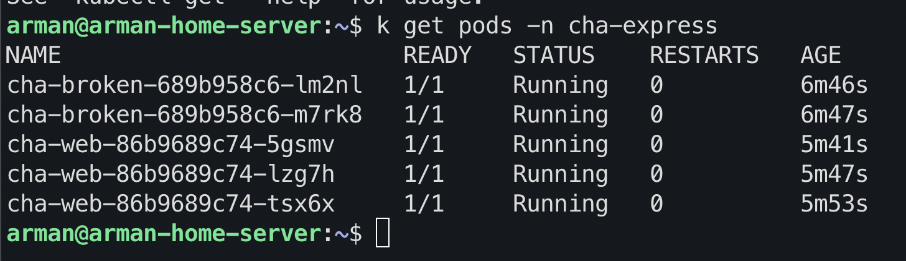

# Rahim Mama's Cha

Online menu for a Dhaka tea stall, running in namespace `cha-express` on Minikube.

## Apply

```bash
minikube start
kubectl apply -f manifests/namespace.yaml
kubectl apply -f manifests/configmap.yaml -f manifests/secret.yaml -f manifests/deployment.yaml -f manifests/service.yaml
```

`manifests/deployment.yaml` is the Task 4 release (`nginx:1.25-alpine`). Task 6 moved the running Deployment to `nginx:1.27-alpine`. Applying that file again sets the image back to `1.25-alpine`.

Open the menu:

```bash
minikube service cha-web -n cha-express
```

The Service is a NodePort on port **30080**. With the Docker driver, use the `minikube service` URL from the host. From inside the node, `http://127.0.0.1:30080` reaches it directly.

## Layout

| Path | What it is |
| --- | --- |
| `manifests/` | Namespace, ConfigMap, Secret, Deployment, Service |
| `debug/cha-broken.yaml` | Task 7 manifest, unchanged |
| `debug/cha-broken-fixed.yaml` | The same manifest with the four bugs fixed |
| `docs/ANSWERS.md` | Written answers and command evidence |
| `docs/evidence/` | Raw command output from the cluster |
| `docs/menu.png` | Browser screenshot of the menu |
| `images/image.png` | `kubectl get pods -n cha-express` |

## Current cluster state



- Deployment `cha-web`: 3 ready pods, image `nginx:1.27-alpine`, NodePort 30080
- ConfigMap `cha-config`: theme `#1F6B4A` and the evening-special menu (bonus)
- Deployment `cha-broken`: the fixed debug release, serving Nginx's default page

